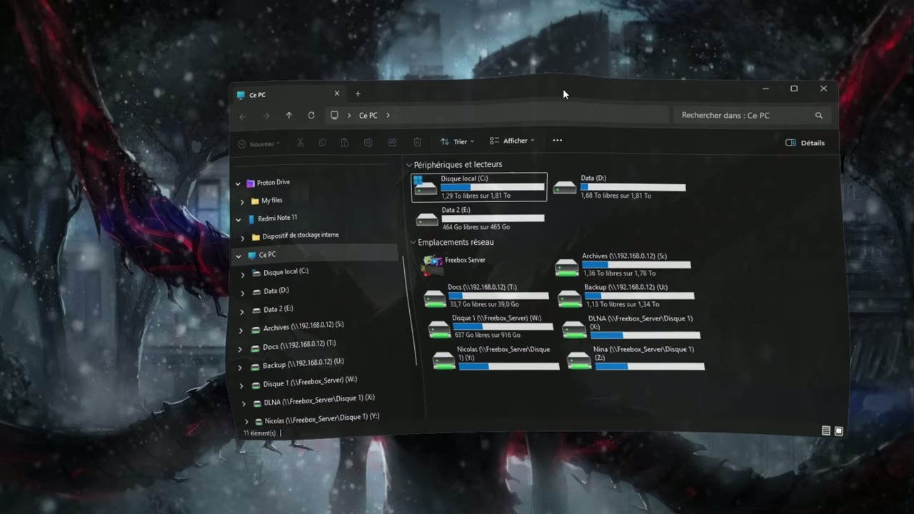
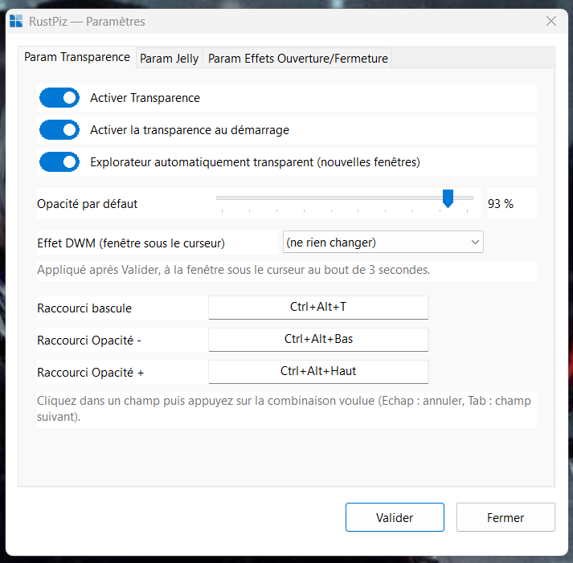
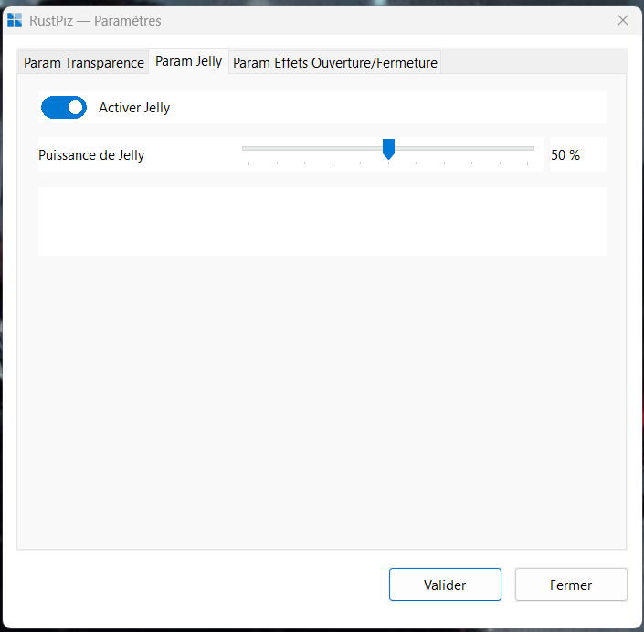
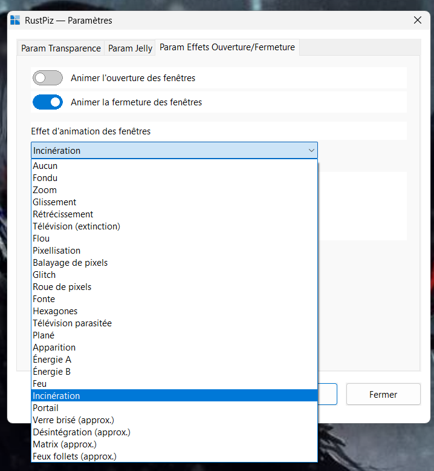

# RustPiz

> **🤖 Projet entièrement généré par Claude (Anthropic).**
> Aucune ligne de code de ce dépôt n'a été écrite par un humain : le code Rust,
> les shaders HLSL, la documentation et ce README ont été produits par Claude.
> Le rôle de l'humain s'est limité à décrire les besoins, tester l'application
> sous Windows et valider (ou non) chaque version.

**RustPiz** (contraction de *Rust* et *Compiz*) est une application Windows native
en **Rust** qui habille les fenêtres de Windows 11 d'effets modernes, le tout
rendu par le GPU. Elle repose sur trois grandes fonctionnalités :

- 🪟 **Transparence** des fenêtres et effets DWM (Mica, Acrylique, Verre) ;
- 🍮 **Jelly** : les fenêtres se déforment élastiquement quand on les déplace ;
- ✨ **Effets d'ouverture et de fermeture** des fenêtres (fondu, zoom, feu,
  portail, pixellisation, etc.).

Tout se pilote depuis l'**icône de la zone de notification**, une **fenêtre de
paramètres native** et des **raccourcis clavier globaux**.

- Aucune dépendance à .NET, exécutable autonome (~1 Mo).
- Conçu pour Windows 11 (build ≥ 22000, vérifié avec 26H2), x64.
- Aucune injection dans les autres processus.

<p align="center">
  <a href="https://github.com/Amethystedev/RustPiz/releases/download/v0.5.0/demo_RustPiz.mp4">
    
  </a>
  <br>
  <em>▶ Cliquez pour voir la vidéo de démonstration (Transparence, Jelly, effets d'ouverture et de fermeture)</em>
</p>

## Sommaire

1. [Installation](#installation)
2. [Utilisation](#utilisation)
3. [Transparence](#transparence)
4. [Jelly](#jelly)
5. [Effets d'ouverture et de fermeture](#effets-douverture-et-de-fermeture)
6. [Configuration](#configuration-appdatarustpizconfigtoml)
7. [Journalisation et limitations](#journalisation)
8. [Compilation](#compilation-pour-les-développeurs)
9. [Licence](#licence)

## Installation

1. Téléchargez `rustpiz-vX.Y.Z-windows-x64.exe` depuis la page
   [Releases](https://github.com/Amethystedev/RustPiz/releases) et placez-le où
   vous voulez (ex. `C:\Outils\`).
2. Double-cliquez : une **notification** confirme le démarrage et une icône
   apparaît dans la zone de notification (éventuellement sous le chevron « ^ »).
3. Au premier lancement, la configuration est créée dans
   `%APPDATA%\RustPiz\config.toml`.

Pour un démarrage automatique de Windows : placez un raccourci vers l'exécutable
dans `shell:startup` (`Win+R` → `shell:startup`).

> ⚠️ Au premier lancement, **SmartScreen** peut afficher un avertissement
> « éditeur inconnu » (binaire non signé) : « Informations complémentaires » →
> « Exécuter quand même ».

## Utilisation

### L'icône de la zone de notification

Un **clic droit** sur l'icône ouvre un menu à trois entrées :

| Entrée                         | Action                                                             |
| ------------------------------ | ------------------------------------------------------------------ |
| **Paramètres**                 | Ouvre la fenêtre de paramètres (tous les réglages)                 |
| **Recharger la configuration** | Applique les modifications faites à la main dans `config.toml`     |
| **Quitter**                    | Restaure toutes les fenêtres puis ferme l'application              |

Un **double-clic** sur l'icône active / désactive la transparence (interrupteur
général ; la désactivation restaure toutes les fenêtres).

### La fenêtre de paramètres

La fenêtre compte **trois onglets**, un par grande fonctionnalité. À son
ouverture, elle relit `config.toml` pour pré-remplir tous les réglages.

- **Valider** enregistre `config.toml` et applique les réglages immédiatement ;
- **Fermer** (ou `Echap`, ou la croix) ferme la fenêtre **sans rien enregistrer**.

Navigation au clavier : `Tab` passe au contrôle suivant, `Echap` ferme.

### Raccourcis clavier

Les raccourcis agissent sur la **fenêtre située sous le curseur de la souris**.
Ils sont modifiables dans l'onglet *Param Transparence*.

| Raccourci par défaut | Action                                             |
| -------------------- | -------------------------------------------------- |
| `Ctrl+Alt+T`         | Activer / désactiver la transparence de la fenêtre |
| `Ctrl+Alt+Haut`      | Augmenter l'opacité (+10 %)                        |
| `Ctrl+Alt+Bas`       | Diminuer l'opacité (−10 %)                         |

Pour changer un raccourci : cliquez dans le champ correspondant puis appuyez sur
la combinaison voulue (`Echap` annule la capture). Une combinaison doit contenir
`Ctrl`, `Alt` ou `Win` (sauf les touches `F1` à `F24`), et deux raccourcis ne
peuvent pas être identiques.

## Transparence

Rend les fenêtres plus ou moins transparentes (`WS_EX_LAYERED` +
`SetLayeredWindowAttributes`) et leur applique des effets DWM modernes. L'état
d'origine de chaque fenêtre est restauré exactement à la désactivation et à la
fermeture de l'application.

<p align="center">
  
</p>

### Onglet « Param Transparence »

| Réglage                                              | Description                                                                                 |
| ---------------------------------------------------- | ------------------------------------------------------------------------------------------- |
| **Activer Transparence**                             | Interrupteur général (équivalent du double-clic sur l'icône)                                |
| **Activer la transparence au démarrage**             | Active la transparence dès le lancement de RustPiz                                          |
| **Explorateur automatiquement transparent**          | Rend transparentes les fenêtres de l'Explorateur déjà ouvertes et les nouvelles (scan toutes les 2 s) |
| **Opacité par défaut**                               | Curseur de 10 % (très transparent) à 100 % (opaque)                                         |
| **Effet DWM (fenêtre sous le curseur)**              | Aucun, Mica, Mica Alt, Acrylique ou Verre ; appliqué **3 secondes après Valider** à la fenêtre sous le curseur (le choix « (ne rien changer) » n'y touche pas) |
| **Raccourci bascule / Opacité − / Opacité +**        | Champs de capture des trois raccourcis globaux                                              |

### Effets DWM (Windows 11 22H2 et +)

| Effet         | Description                                                |
| ------------- | ---------------------------------------------------------- |
| **Mica**      | Matière opaque teintée du fond d'écran                     |
| **Mica Alt**  | Variante Mica plus prononcée (fenêtres à onglets)          |
| **Acrylique** | Flou translucide                                           |
| **Verre**     | Feuille de verre complète (`DwmExtendFrameIntoClientArea`) |

Les effets sont restaurés à leur état d'origine en désactivant la transparence
et à la fermeture de l'application.

### Protections intégrées

Par défaut, RustPiz **ignore** : la barre des tâches, le menu Démarrer, le
centre de notifications, les menus contextuels du shell, le bureau, l'écran de
verrouillage et **toute fenêtre plein écran** (cas de la plupart des jeux).

### Profils automatiques

Dans `config.toml`, des `[[profils]]` appliquent une opacité et/ou un effet DWM
aux nouvelles fenêtres selon leur processus, leur classe ou leur titre
(voir [Configuration](#configuration-appdatarustpizconfigtoml)).

## Jelly

Quand on **déplace une fenêtre** en glissant sa barre de titre, elle se déforme
élastiquement (traînée proportionnelle à la vitesse) puis revient à sa forme avec
un rebond amorti, façon [Jello](https://github.com/iamDecode/Jello) sur macOS.

<p align="center">
  
</p>

### Onglet « Param Jelly »

| Réglage                | Description                                                    |
| ---------------------- | -------------------------------------------------------------- |
| **Activer Jelly**      | Active l'effet (désactivé par défaut)                          |
| **Puissance de Jelly** | Curseur de 0 % à 100 %, toutes les valeurs (0 % = aucun mouvement) |

Désactivé ou à 0 %, l'effet ne consomme rien.

### Principe (100 % GPU)

La fenêtre est capturée (Windows.Graphics.Capture), sa texture reste sur le GPU
et est dessinée par Direct3D 11 sur un **vrai maillage courbe** simulé par un
système masses-ressorts, puis présentée via une swapchain de composition
DirectComposition, synchronisée sur le rafraîchissement de l'écran.

### Limites

- le contenu de la fenêtre est figé pendant le glissement, sans ombre DWM ;
- un Snap, un redimensionnement ou un changement de DPI terminent l'effet sans
  rebond ;
- si le GPU matériel est indisponible ou si le pipeline échoue, le Jelly est
  désactivé pour la session (notification + `journal.log`) ;
- si le processus est tué pendant l'effet, la fenêtre peut rester quasi
  invisible : la fermer puis la rouvrir.

## Effets d'ouverture et de fermeture

Les fenêtres des autres applications peuvent être animées à l'ouverture et à la
fermeture, avec le même effet dans les deux sens (l'ouverture est la fermeture
jouée à l'envers).

<p align="center">
  
</p>

### Onglet « Param Effets Ouverture/Fermeture »

| Réglage                                  | Description                                          |
| ---------------------------------------- | ---------------------------------------------------- |
| **Animer l'ouverture des fenêtres**      | Interrupteur (désactivé par défaut)                  |
| **Animer la fermeture des fenêtres**     | Interrupteur (désactivé par défaut)                  |
| **Effet d'animation des fenêtres**       | Liste de tous les effets disponibles                 |

### Effets disponibles

- **Effets classiques** : Aucun, Fondu, Zoom, Glissement, Rétrécissement,
  Télévision (extinction), Flou.
- **Effets à shaders (HLSL, rendus par le GPU)** : Pixellisation, Balayage de
  pixels, Glitch, Roue de pixels, Fonte, Hexagones, Télévision parasitée, Plané,
  Apparition, Énergie A, Énergie B, Feu, Incinération, Portail.
- **Approximations** (suffixe « (approx.) » dans la liste) : Verre brisé,
  Désintégration, Matrix, Feux follets.

Ces effets s'inspirent de l'extension GNOME Shell
[Burn-My-Windows](https://github.com/Schneegans/Burn-My-Windows) ; les shaders
sont toutefois **écrits indépendamment** (Burn-My-Windows est sous GPL-3, ce
projet sous MIT). Si la compilation d'un shader échoue, l'effet est signalé
« (indisponible : voir journal) » et RustPiz se replie sur le fondu.

### Principe (GPU)

Le contenu de la fenêtre est capturé par Windows.Graphics.Capture (textures
Direct3D 11 laissées sur le GPU), puis rejoué dans une fenêtre de surimpression
DirectComposition : soit animée par le compositeur Windows (effets classiques),
soit rendue par un pixel shader (effets à shaders).

### Limites

- la fermeture animée fonctionne surtout pour la fenêtre au premier plan (seule
  celle-ci est suivie en continu) ;
- l'ouverture masque temporairement la fenêtre et attend qu'elle soit réellement
  peinte avant de jouer l'effet : elle apparaît donc avec un léger retard
  (environ 0,1 à 0,4 s, 0,75 s au plus) ; si aucune image exploitable n'arrive à
  temps, elle s'affiche sans animation ; si Windows refuse le masquage,
  l'animation d'ouverture est désactivée automatiquement pour la session ;
- si le processus est tué pendant une animation d'ouverture, la fenêtre
  concernée pourrait rester masquée : la fermer puis la rouvrir ;
- l'effet « T-Rex Attack » de Burn-My-Windows n'est pas reproduit.

## Configuration (`%APPDATA%\RustPiz\config.toml`)

Tous les réglages de la fenêtre de paramètres sont enregistrés dans ce fichier.
Vous pouvez aussi l'éditer à la main (puis **Recharger la configuration** dans
le menu de l'icône, ou redémarrer).

```toml
opacite_defaut = 80            # opacité en % (10 = très transparent, 100 = opaque)
activer_au_demarrage = true
transparence_explorateur = true # Explorateur transparent automatiquement
effet_fenetre = "zoom"         # animation d'ouverture/fermeture
effet_ouverture = false
effet_fermeture = false
jelly_actif = false            # effet Jelly au déplacement des fenêtres
jelly_puissance = 50           # 0 à 100

[raccourcis]
bascule = "Ctrl+Alt+T"         # format : Ctrl/Alt/Shift/Win + touche
augmenter = "Ctrl+Alt+Haut"
diminuer = "Ctrl+Alt+Bas"

exclusions_classes = [ ... ]   # classes de fenêtres jamais modifiées
exclusions_processus = [ ... ] # processus jamais modifiés (ex. "monjeu.exe")

# Profils automatiques (appliqués aux nouvelles fenêtres, scan toutes les 2 s) :
[[profils]]
nom = "Explorateur Mica"
processus = "explorer.exe"     # critères : processus, classe, titre_contient
classe = "CabinetWClass"
effet_dwm = "mica"             # aucun | mica | micaalt | acrylique | verre

[[profils]]
nom = "Bloc-notes translucide"
processus = "notepad.exe"
opacite = 85
```

> Le dossier de configuration est `%APPDATA%\RustPiz`. Un ancien dossier
> `%APPDATA%\TransparentWindows` (nom du projet avant l'ajout des effets) est
> migré automatiquement au premier lancement.

## Journalisation

Les événements et erreurs sont consignés dans `%APPDATA%\RustPiz\journal.log`
(y compris la version de Windows détectée). En cas de comportement inattendu,
c'est le premier fichier à consulter. Il contient le processus, la classe et le
début du titre des fenêtres concernées par les animations : relisez-le avant de
le partager.

## Limitations connues

- Certaines applications modernes (WinUI 3, Electron avec accélération GPU)
  peuvent afficher des artefacts avec `WS_EX_LAYERED` ou ignorer les effets DWM.
- L'effet « Verre » sur une fenêtre qui gère déjà ses marges DWM peut produire
  des rendus inattendus ; « Aucun » restaure l'état d'origine.
- Si le processus est tué brutalement (gestionnaire des tâches), les fenêtres
  modifiées ne peuvent pas être restaurées automatiquement ; fermer puis rouvrir
  la fenêtre concernée suffit. La fermeture de session Windows, elle, est gérée.

## Compilation (pour les développeurs)

Le développement se fait sous Linux avec cross-compilation MinGW ; la cible par
défaut est `x86_64-pc-windows-gnu` (voir `.cargo/config.toml`).

```bash
cargo check
cargo build --release
```

L'exécutable est généré dans
`target/x86_64-pc-windows-gnu/release/rustpiz.exe`.

## Licence

MIT.
